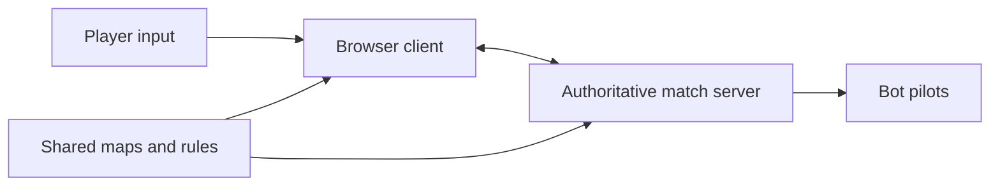

# Spirefall

**Browser arena combat inside a decaying industrial spire.** A TypeScript client and authoritative WebSocket server share movement, weapons and arena rules.

[简体中文](README.zh-CN.md) · [Development status](docs/PROGRESS.md) · [Documentation history](docs/README-history.md)


*Actual gameplay screenshot preserved from public revision `b291ee1`; it shows an earlier visual baseline, not the latest local art pass. [Source and provenance](docs/showcase/README.md).*

## Explore the game

| System | What is in the public source |
|---|---|
| Arena combat | Platform movement, ranged and melee weapons, ricochets, cover and environmental hazards |
| Multiplayer | Rooms, server-authoritative simulation, reconnect handling, free-for-all and squad modes |
| AI pilots | Host-controlled bots for local matches and filling room slots |
| Shared rules | Protocol, physics, maps and weapon definitions in `shared/` |



## Run locally

Requires Node.js and npm. Restore the locked dependencies, then start the development client and server:

```bash
npm ci
npm run dev
```

Open `http://127.0.0.1:5173`. The WebSocket server uses port `8787`. For a compiled client served from the game server:

```bash
npm run build
npm start
```

Open `http://127.0.0.1:8787`. Avoid starting a second server on the same ports. Existing managed local checkouts may provide their own service-control scripts.

## Development and status

This is a development game, with technical checks and player acceptance recorded separately. See [PROGRESS](docs/PROGRESS.md) for the current revision, known loading/rendering issues and unfinished playtests. The screenshot above is historical and does not certify the current build. Campaign and art experiments in development notes are not all released playable content.

```bash
npm run build
npm run test:logic
npm run test:smoke
```

The repository also contains browser, AI, visual and performance suites; read `package.json` and their setup before running them. This documentation pass did not rerun gameplay acceptance.

## Source and license

See `src/`, `server/`, `shared/` and `tests/` for the implementation; [development status](docs/PROGRESS.md) retains project-specific decisions. Original source is under [MIT](LICENSE). Reference-game binaries and third-party reference artwork are not redistributed as this project's original assets.
