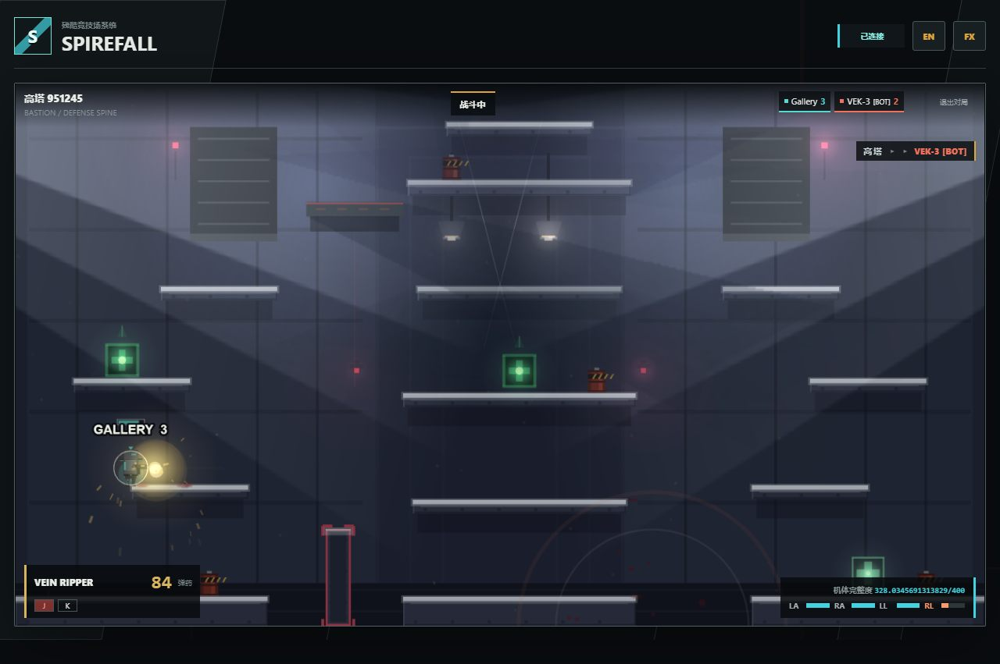
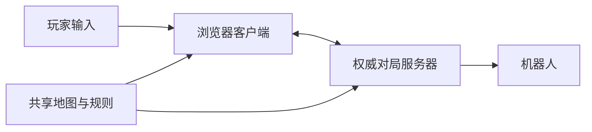

# Spirefall

**在衰败工业巨构中展开的浏览器竞技战斗。** TypeScript 客户端与权威 WebSocket 服务器共用移动、武器和地图规则。

[English](README.md) · [开发状态](docs/PROGRESS.md) · [文档历史](docs/README-history.md)



*来自公开版本 `b291ee1` 的真实游戏截图，对应较早的视觉基线，不代表本机最新美术版本。[来源说明](docs/showcase/README.md)。*

## 玩法与实现

| 系统 | 公开源码已有内容 |
|---|---|
| 竞技战斗 | 平台移动、远近程武器、弹射、掩体及环境危险 |
| 多人对局 | 房间、服务端权威模拟、重连、混战与小队模式 |
| AI 驾驶员 | 房主控制的机器人，支持本机对局与补位 |
| 共用规则 | `shared/` 中的协议、物理、地图与武器定义 |



## 本机运行

需要 Node.js 与 npm。先恢复锁定依赖，再启动开发客户端及服务器：

```bash
npm ci
npm run dev
```

打开 `http://127.0.0.1:5173`，WebSocket 服务器端口为 `8787`。使用由游戏服务器直接提供的构建版：

```bash
npm run build
npm start
```

打开 `http://127.0.0.1:8787`，避免在同端口重复启动服务器。已有本机托管环境可能另有自己的服务控制脚本。

## 状态与验证

项目仍在开发；技术检查和玩家体验验收分别记录。当前版本、加载／渲染问题及待补试玩见 [PROGRESS](docs/PROGRESS.md)。上图属于历史实录，不能证明当前构建已通过验收。开发记录中的战役、美术实验并非全部已经发布为可玩内容。

```bash
npm run build
npm run test:logic
npm run test:smoke
```

仓库还提供浏览器、AI、视觉与性能测试；运行前阅读 `package.json` 及相应环境说明。本次文档整理没有重跑游戏体验验收。

## 源码与许可

主要实现位于 `src/`、`server/`、`shared/`，验证入口位于 `tests/`；项目决策保留在 [开发状态](docs/PROGRESS.md)。原创源码适用 [MIT](LICENSE)。参考游戏二进制和第三方参考画作不作为本项目原创资产再分发。
